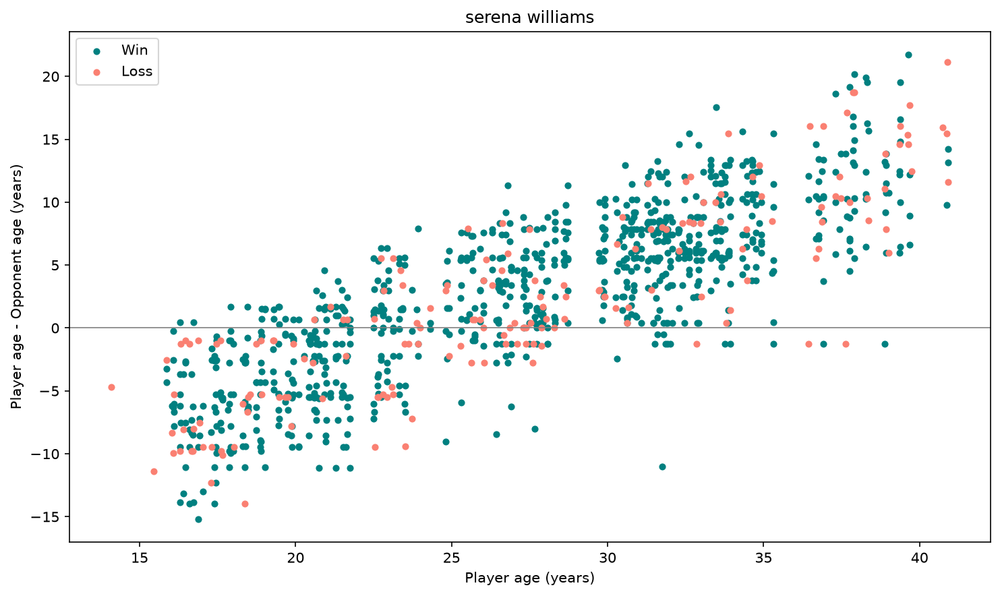
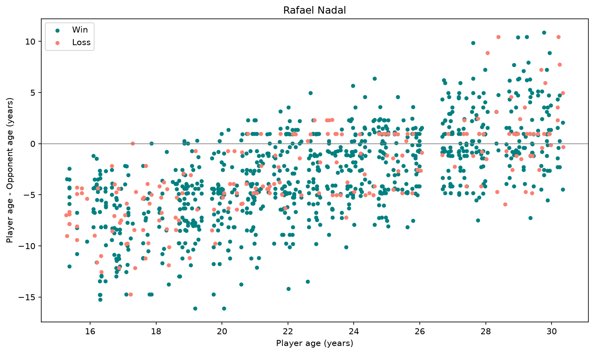

# tenniscareer

A Python package that retrieves tennis match records from Tennis Abstract
and plots a player's age against the age difference between the player
and their opponent.

This package was developed for STAT 159 HW3.

## Installation

Install the package directly from GitHub:

```bash
python -m pip install git+https://github.com/UCB-stat159-f26/hw03-3-yhkimslv.git
```

## Usage

The package provides two public functions:

- `get_career_data(player_name)` retrieves and cleans match records,
  returning a pandas DataFrame.
- `plot_career(data)` creates a scatter plot and returns a Matplotlib Axes.

```python
from tenniscareer import get_career_data, plot_career

# Serena Williams
serena = get_career_data("serena williams")
print(serena.head())

ax = plot_career(serena)
ax.figure.savefig("serena_career.png", bbox_inches="tight")

# Rafael Nadal
rafael = get_career_data("Rafael Nadal")
print(rafael.head())

ax = plot_career(rafael)
ax.figure.savefig("rafael_career.png", bbox_inches="tight")
```

The following name formats are supported:

```python
get_career_data("serena williams")
get_career_data("Serena Williams")
get_career_data("SerenaWilliams")
```

An invalid player name should produce a meaningful error message.

Retrieving player data requires an internet connection.

## Run the example script

From the root of the cloned repository, run:

```bash
python example.py
```

The script prints the first five rows for each player and saves
two graphs in the current working directory:

- `serena_career.png`
- `rafael_career.png`

The example script belongs to the repository and is not installed
as a command by pip.

## Example plots

The x-axis shows the player's age at the recorded event date.
The y-axis shows the player's age minus the opponent's age.
Wins are teal, and losses are salmon.

### Serena Williams



### Rafael Nadal



## Returned data

`get_career_data()` returns a DataFrame with these columns:

| Column | Description |
| --- | --- |
| `date` | Recorded event date |
| `result` | Match result: `W` or `L` |
| `opponent` | Opponent's name |
| `player_age` | Player's age in years |
| `opponent_age` | Opponent's age in years |
| `age_diff` | Player's age minus opponent's age |

Ages calculated from birthdates use elapsed days divided by 365.25:

```text
player_age = (event_date - player_birthdate).days / 365.25
```

Female-player source files contain opponents' birthdates, so their
ages are calculated using the same method. Male-player source files
already contain opponents' numeric ages.

```text
age_diff = player_age - opponent_age
```

A positive difference means the player was older than the opponent.
A negative difference means the player was younger.

The cleaning process removes duplicate raw records and drops rows
with missing values in the final columns. Invalid dates are converted
to missing values before those rows are removed.

## Package structure

| File | Purpose |
| --- | --- |
| `tenniscareer/download.py` | Format player names, download source text, and retrieve birthdates |
| `tenniscareer/clean_date.py` | Extract match records, convert dates, and calculate ages |
| `tenniscareer/data.py` | Define `get_career_data()` |
| `tenniscareer/plot.py` | Define `plot_career()` |
| `tenniscareer/__init__.py` | Expose the two public functions |
| `tenniscareer/tests/test_data.py` | Test data-processing helper functions |
| `example.py` | Demonstrate retrieval and plotting for two players |

## Testing

From the root of the cloned repository, install the package with
its test dependency:

```bash
python -m pip install -e ".[test]"
```

Run the tests:

```bash
python -m pytest tenniscareer/tests -q
```

The current test suite contains seven tests covering:

- Player-name formatting.
- Age calculations using female opponents' birthdates.
- Conversion of male opponents' numeric ages.
- Removal of records with invalid dates.
- Missing opponent ages.
- Source text without match records.
- Empty player names.

The tests use local mock files:

```text
tenniscareer/tests/data/FemalePlayerCareer.JS
tenniscareer/tests/data/MalePlayerCareer.JS
```

Automated tests do not contact live servers.
The example script separately demonstrates live data retrieval.

## Data sources and coverage

Data was retrieved from [Tennis Abstract](https://www.tennisabstract.com/),
including player match records and birthdate information.

The plots reflect the records available in the source files.
The source files inspected during development contained the following
records after cleaning:

| Player | Records | Earliest recorded date | Latest recorded date |
| --- | ---: | --- | --- |
| Serena Williams | 1,038 | 1995-10-30 | 2022-08-29 |
| Rafael Nadal | 1,096 | 2001-09-10 | 2016-10-10 |

These ranges describe the source copies checked during development.
Live source files may change.

The Nadal example does not represent his complete career.
Its coverage ends in October 2016 because that is the latest
recorded date in the source file inspected.

The text parser expects one match record per line.

## Reflections

I learned how to organize code into a Python package by separating
downloading, data cleaning, and plotting into different modules.
Keeping two public functions made the package easier to use while
allowing smaller helper functions to handle individual tasks.

Testing helped me identify several details I had initially missed.
Creating mock files with `touch` did not fill them with data.
I also learned that the result of `pd.to_datetime()` must be assigned
back to the DataFrame column, and that the date format should be
passed using `format=`. Calculating expected ages from dates in the
tests made the results easier to understand.

I also learned that `git commit` includes all staged files.
After accidentally committing the example files together with a
`.gitignore` change, I separated them into two commits. Checking
`git diff --cached --name-only` before committing helps me confirm
which files will be included.

## License

This package is distributed under the BSD 3-Clause License.
See [LICENSE](LICENSE) for details.